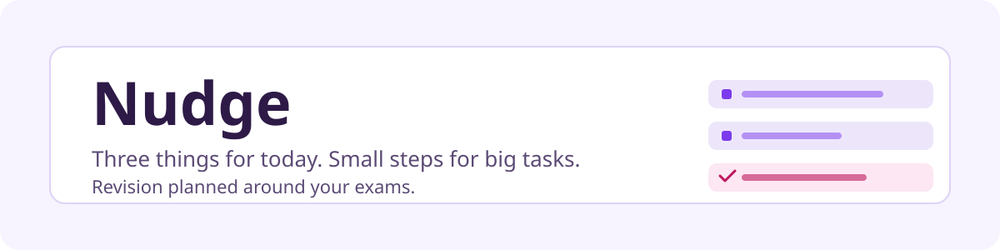

# Nudge



A life planner for people whose attention comes in bursts. Nudge shows you three things for today, breaks big tasks into small steps, and plans revision around your exams.

Nudge runs on Cloudflare. A Worker serves the app and its API, D1 stores your data, and Workers AI powers the planning helpers. The frontend is one HTML file with no framework and no build step.

## What it does

- **Today:** up to three priorities for the day. "Just start 5 min" starts a short focus session on the first one. "Plan my day" suggests three priorities from your open tasks.
- **Inbox:** capture anything in one field, then sort it with one tap into a task, a goal step, a Today item, a reminder or a note.
- **Goals:** goals grouped by life area, each with small steps. "Break it down" turns a goal into 3 to 7 steps with Workers AI.
- **Study:** exams with countdowns, topics per course, quizzes linked to topics, and a Plan screen with every day up to the last exam.
- **Quiz replanning:** pick the topics a quiz covers, preview a new schedule, then apply it. Revision for those topics lands before the quiz, and the rest lands before the exam.
- **Exam-eve rule:** every course task is due by the day before its exam. Tasks past that point show a "Too late" label with a one-tap fix.
- **Assistant:** a chat panel that proposes changes to your plan, such as moving tasks or adding a quiz. Nothing changes until you tick the proposals and apply them.
- **Routines and habits:** morning and evening checklists, and habits shown as "x of the last 7 days" rather than streaks that reset.
- **Focus timer and reminders:** a focus timer with breaks, and reminders that ring while the page is open.

## Run it locally

You need Node.js 18 or newer and a Cloudflare account for D1 and Workers AI.

```bash
npm install
```

Create your own D1 database and put its ID in `wrangler.toml`:

```bash
npx wrangler d1 create onething-db
```

Create the tables and seed the default areas:

```bash
npm run db:local
npm run db:migrate:local
```

Set a PIN for local development in `.dev.vars`, which is ignored by git:

```bash
echo 'PIN=choose-a-pin' > .dev.vars
```

Start the app:

```bash
npm run dev
```

Open the printed address, enter your PIN when asked, and you're in.

## Deploy

Create the tables in your remote database, then deploy:

```bash
npm run db:remote
npm run db:migrate
npm run deploy
```

Set the PIN on the deployed Worker. Without a PIN, anyone with the URL can read and edit your data:

```bash
npx wrangler secret put PIN
```

## Project layout

| Path | What's in it |
|---|---|
| `src/worker.js` | API routes, D1 access and the Workers AI helpers |
| `public/index.html` | The whole frontend: markup, styles and script |
| `schema.sql` | Tables for a fresh database |
| `migrations/001_v2.sql` | Adds the planner tables and columns to an existing database |
| `design-system/nudge/` | Design tokens and the API contract between frontend and backend |
| `wrangler.toml` | Worker name, asset folder, D1 and AI bindings |

## Limits

- **Single user:** the only protection is one shared PIN. There are no accounts.
- **Reminders need an open page:** they ring while the app is open in a tab, not in the background.
- **AI needs Workers AI:** without it, "Plan my day", "Break it down" and the assistant show a quiet message and the rest of the app still works.
- **Model choice:** the AI model is set by one constant, `M`, at the top of `src/worker.js`. Check the Cloudflare model catalog before changing it, since models are retired over time.
- **Your data stays in D1:** course and topic data is yours, not shipped with the code.

## Contributing

Open an issue to talk about a change before you start on a large one. Keep changes small, match the existing style of the code, and run the app locally before opening a pull request.
